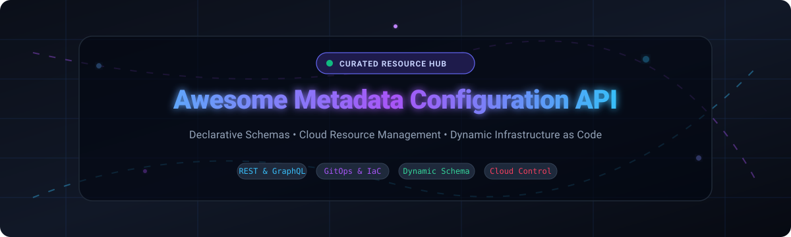

# ⚡ Awesome Metadata Configuration API

  

  
  
  
  
  

---

## 📖 Introduction & Overview

Welcome to the definitive, SEO-optimized curated index of **Metadata Configuration APIs**, **Declarative Schema Management Tools**, **Control Plane APIs**, and **Infrastructure as Code (IaC) Frameworks**. 

Modern cloud platforms, enterprise CRMs, and distributed microservices rely on metadata-driven architectures. Rather than hardcoding infrastructure or schema state, these platforms expose programmatic REST, GraphQL, gRPC, and RPC endpoints to dynamically define, query, provision, and mutate application schemas, access policies, data models, and cloud resources.

### 🎯 Key Highlights
- ☁️ **Cloud Resource & Control Plane APIs**: Declarative infrastructure definition via unified schema protocols.
- 🗄️ **Schema & Metadata-Driven Engines**: Automated REST/GraphQL API generation from relational and NoSQL metadata definitions.
- ⚙️ **GitOps & Policy-as-Code Configuration**: End-to-end continuous reconciliation and governance validation.

---

## 📈 Sector Overview & Market Dynamics

The global market for **Cloud Configuration, Metadata Management, and Infrastructure Automation APIs** is estimated at **$18.5 Billion to $22.4 Billion**, growing at an aggressive compound annual growth rate (CAGR) of ~21%. 

Market dynamics demonstrate a **moderately fragmented yet tiered bifurcation**:
- **Hyperscale Core (Concentrated)**: The underlying infrastructure and control plane resource management tier is highly concentrated among mega-cap hyperscalers (Microsoft Azure, Amazon AWS, Google Cloud) and platform giants (Salesforce, ServiceNow, Atlassian), creating strong "winner-take-most" gravitational lock-in for enterprise ecosystems.
- **Application & Data Schema Layer (Moderately Fragmented)**: The metadata configuration layer for headless databases, low-code/no-code platforms, API gateways, and custom internal developer portals remains vibrant and fragmented, driven by modern open-source alternatives and specialized cloud-native tools.

---

## 📑 Table of Contents
- [Sector Overview & Market Dynamics](#-sector-overview--market-dynamics)
- [SaaS & Hosted Platforms](#-saashosted-platforms)
- [Open-Source GitHub Projects](#-open-source-github-projects)
- [Architecture Patterns & Frameworks](#-architecture-patterns--frameworks)
- [How to Contribute](#-how-to-contribute)
- [Support & Community](#-support)
- [Star History](#-star-history)
- [Disclaimer & License](#-disclaimer)

---

## ☁️ SaaS/Hosted Platforms

The following hosted platforms provide robust, production-grade metadata configuration APIs. Sorted descending by company size (market valuation / annual revenue).

| 🏢 Platform | 💰 Company Valuation / Revenue | 🏷️ Specific Starting Pricing Tier | 🎁 Specific Free Tier / Trial Limits | 🔍 Metadata API Capabilities |
| :--- | :--- | :--- | :--- | :--- |
| **[Microsoft Azure Resource Manager (ARM)](https://azure.microsoft.com/en-us/features/resource-manager/)** | **~$3.10 Trillion** (Market Cap) | Pay-as-you-go; ARM API operations & management layer are $0.00 (underlying compute billed separately, e.g. B1s VM from $7.59/mo) | Free forever account: 55+ always-free services + $200 Azure credit for 30 days | Declarative JSON/Bicep APIs for full Azure resource topology, RBAC metadata, and policy deployment. |
| **[Google Cloud Resource Manager API](https://cloud.google.com/resource-manager)** | **~$2.15 Trillion** (Market Cap / Alphabet) | Pay-as-you-go; Resource Manager API requests are $0.00 (managed services billed e.g., e2-micro compute from $6.11/mo) | Free tier forever: 1 e2-micro VM, 30 GB storage + $300 credit over a 90-day free trial | Programmatic hierarchical control across Organizations, Folders, Projects, and IAM binding metadata. |
| **[AWS Cloud Control API](https://aws.amazon.com/cloudcontrolapi/)** | **~$1.95 Trillion** (Market Cap / Amazon) | Pay-as-you-go; $0.00 per Cloud Control API call (standard underlying AWS resource usage charges apply) | Always Free: 1M API Gateway calls/mo, 1M Lambda reqs/mo, plus 12-month free tier (750h t2.micro/mo) | Standardized CRUD-L operations for AWS & third-party registered resources using JSON schemas. |
| **[Salesforce Metadata API](https://developer.salesforce.com/docs/atlas.en-us.api_meta.meta/api_meta/)** | **~$275 Billion** (Market Cap) | Starter Suite from $25/user/month (billed annually); Enterprise edition from $165/user/month for full API access | 30-day full-featured free trial with pre-configured org access and full Developer Edition org free forever | Direct deployment and retrieval of custom objects, page layouts, Apex code, and security profiles. |
| **[ServiceNow Table API](https://developer.servicenow.com/)** | **~$185 Billion** (Market Cap) | Starter ITSM custom packages from ~$100/user/month (enterprise contracts typically start at $10,000/year) | ServiceNow Developer Program: 1 free personal developer instance (PDI) with full administrative access | REST API for programmatic schema introspection, dynamic table/field definition, and data dictionary management. |
| **[Atlassian Jira REST API](https://developer.atlassian.com/server/jira/platform/jira-rest-apis-7372883/)** | **~$50 Billion** (Market Cap) | Standard plan starts at $7.75/user/month (minimum 10 users, ~$77.50/month) | Free plan forever for up to 10 users with 2 GB file storage and standard community support | REST API endpoints for issue schema configuration, custom fields, issue types, and workflow automation. |
| **[Datadog Synthetics & Config API](https://docs.datadoghq.com/api/latest/synthetics/)** | **~$40 Billion** (Market Cap) | Pro plan starts at $15/host/month; Synthetics API tests start at $5/month per 10k API test runs | 14-day full-access free trial covering unlimited hosts and synthetic monitors | API-driven creation, update, and deletion of synthetic monitors, alerting triggers, and integration configs. |
| **[Okta Management API](https://developer.okta.com/docs/api/)** | **~$16 Billion** (Market Cap) | Workforce Identity starts at $2/user/month; Okta Customer Identity Cloud starts at $23/month | Free Developer Edition org forever: up to 7,500 monthly active users (MAUs) and 100 app integrations | REST API managing users, groups, application schema definitions, policy frameworks, and authentication profiles. |
| **[GitHub Enterprise Admin API](https://docs.github.com/en/graphql)** | **~$7.5 Billion** (Annual Revenue / Microsoft) | GitHub Team starts at $4/user/month; GitHub Enterprise Cloud starts at $21/user/month | Free plan forever: unlimited public/private repositories with 2,000 GitHub Actions CI/CD minutes/month | GraphQL/REST APIs for organization management, identity scim, repo security policies, and environment variables. |
| **[HashiCorp Cloud Platform (HCP)](https://registry.terraform.io/)** | **~$4.4 Billion** (Acquisition Valuation / IBM) | HCP Terraform starts at $0.00014/applied resource hour (~$0.10/hour per active managed resource) | Free plan forever: up to 500 managed resources per month with standard state management and registry access | Public/private registry API providing provider definitions, module schemas, and workspace configuration states. |

---

## 🚀 Open-Source GitHub Projects

Explore top-rated open-source projects for declarative schema automation, GitOps infrastructure configuration, and headless metadata engines. Sorted descending by GitHub Stars_Count.

| 📦 Repository & Link | ⭐ GitHub_Stars | 📜 License | 💡 Metadata & Configuration Capabilities |
| :--- | :---: | :---: | :--- |
| **[Kubernetes](https://github.com/kubernetes/kubernetes)** |  | Apache-2.0 | Standard container orchestration platform powered by Custom Resource Definitions (CRDs) and API aggregation for declarative configuration. |
| **[Strapi](https://github.com/strapi/strapi)** |  | MIT | Leading open-source headless CMS with Content-Type Builder APIs for dynamic schema modeling and REST/GraphQL endpoint synthesis. |
| **[NocoDB](https://github.com/nocodb/nocodb)** |  | AGPL-3.0 | Open-source Airtable alternative transforming any relational database into a smart spreadsheet with automated metadata REST APIs. |
| **[Twenty CRM](https://github.com/twentyhq/twenty)** |  | AGPL-3.0 | Modern CRM with dedicated `/rest/metadata` endpoints for programmatic custom object, field, and relationship definitions. |
| **[Odoo](https://github.com/odoo/odoo)** |  | LGPL-3.0 | Extensible ERP suite with XML-RPC and JSON-RPC APIs for programmatic model definitions, view configurations, and field metadata. |
| **[Terraform](https://github.com/hashicorp/terraform)** |  | BUSL-1.1 | Industry-standard declarative IaC tool with provider-based resource metadata definitions, state lock engines, and registry protocols. |
| **[Apache Airflow](https://github.com/apache/airflow)** |  | Apache-2.0 | Programmatic workflow orchestration platform with comprehensive DAG metadata APIs for pipeline registration and scheduling. |
| **[Kong Gateway](https://github.com/Kong/kong)** |  | Apache-2.0 | Cloud-native API gateway featuring declarative Admin REST APIs and decK for route, service, consumer, and plugin metadata management. |
| **[Directus](https://github.com/directus/directus)** |  | BSL-1.1 | Instant REST & GraphQL data platform dynamically generated by introspecting and mutating underlying SQL database metadata. |
| **[Keycloak](https://github.com/keycloak/keycloak)** |  | Apache-2.0 | Open-source IAM system featuring an Admin REST API for configuring realms, clients, identity providers, and role metadata. |
| **[Backstage](https://github.com/backstage/backstage)** |  | Apache-2.0 | Open developer portal created by Spotify, exposing Software Catalog APIs for tracking microservices, domains, and team metadata. |
| **[OpenTofu](https://github.com/opentofu/opentofu)** |  | MPL-2.0 | Community-driven, truly open-source fork of Terraform for declarative infrastructure management with backwards-compatible provider APIs. |
| **[Kestra](https://github.com/kestra-io/kestra)** |  | Apache-2.0 | Declarative workflow and data orchestrator with YAML-based flow definitions and REST APIs for flow topology metadata. |
| **[Pulumi](https://github.com/pulumi/pulumi)** |  | Apache-2.0 | Modern infrastructure as code using TypeScript, Python, Go, and C# with schema-driven resource models and state APIs. |
| **[Argo CD](https://github.com/argoproj/argo-cd)** |  | Apache-2.0 | Declarative GitOps continuous delivery tool for Kubernetes with Application and AppProject metadata configuration APIs. |
| **[Temporal](https://github.com/temporalio/temporal)** |  | MIT | Microservice orchestration platform with gRPC/REST APIs for workflow definition metadata and namespace configurations. |
| **[Open Policy Agent (OPA)](https://github.com/open-policy-agent/opa)** |  | Apache-2.0 | General-purpose policy engine with Policy & Data REST APIs for metadata governance across microservices, Kubernetes, and CI/CD. |
| **[Crossplane](https://github.com/crossplane/crossplane)** |  | Apache-2.0 | Kubernetes-based universal control plane enabling teams to build custom self-service infrastructure APIs using XRDs and compositions. |
| **[Flux CD](https://github.com/fluxcd/flux2)** |  | Apache-2.0 | Suite of open GitOps operators for Kubernetes providing Kustomization and HelmRelease metadata configuration APIs. |
| **[Kyverno](https://github.com/kyverno/kyverno)** |  | Apache-2.0 | Kubernetes native policy management engine using ClusterPolicy and Policy CRDs without requiring complex custom coding. |
| **[Baserow](https://github.com/baserow/baserow)** |  | MIT | Open-source no-code relational database providing REST APIs for dynamically creating and updating tables, views, and fields. |
| **[OpenStack](https://github.com/openstack)** |  | Apache-2.0 | Ubiquitous cloud operating system orchestrating compute, storage, and networking resources via OpenStack REST service APIs. |
| **[SuiteCRM](https://github.com/salesagility/SuiteCRM)** |  | AGPL-3.0 | Enterprise-ready open-source CRM featuring REST API v8 for metadata-driven module and field layout administration. |
| **[EspoCRM](https://github.com/espocrm/espocrm)** |  | GPL-3.0 | Lightweight web application CRM platform with structured REST API endpoints for entity schema and layout customization. |
| **[Apache CloudStack](https://github.com/apache/cloudstack)** |  | Apache-2.0 | Highly scalable turnkey IaaS cloud platform with automated REST APIs managing compute hypervisors and storage pools. |
| **[Confluent Schema Registry](https://github.com/confluentinc/schema-registry)** |  | Confluent Community | Centralized RESTful interface for storing and retrieving Avro, JSON Schema, and Protobuf metadata for event streaming. |
| **[Apicurio Registry](https://github.com/apicurio/apicurio-registry)** |  | Apache-2.0 | Multi-format event schema and API design registry with full REST API support for schemas, OpenAPI, and AsyncAPI specifications. |
| **[Planton](https://github.com/plantonhq/planton)** |  | Apache-2.0 | Open-source cloud infrastructure automation framework with Pulumi deployment modules for multi-cloud resource orchestration. |

---

## 🛠️ Architecture Patterns & Frameworks

Building a robust, enterprise-grade declarative metadata configuration platform? Consider combining these best-of-breed open-source building blocks:

- 🧱 **Infrastructure Control Plane**: Combine **[OpenTofu](https://github.com/opentofu/opentofu)** or **[Terraform](https://github.com/hashicorp/terraform)** with **[Crossplane](https://github.com/crossplane/crossplane)** for unified infrastructure abstraction across multi-cloud providers.
- 🗃️ **Dynamic Schema & Application Tier**: Use **[Twenty CRM](https://github.com/twentyhq/twenty)** or **[Directus](https://github.com/directus/directus)** to let business logic dictate database schemas dynamically through automated REST/GraphQL APIs.
- 🛡️ **Identity & Security Metadata**: Integrate **[Keycloak](https://github.com/keycloak/keycloak)** for OIDC/SAML metadata and user lifecycle management.
- 📜 **Policy as Code**: Enforce compliance across metadata changes with **[Open Policy Agent (OPA)](https://github.com/open-policy-agent/opa)** and **[Kyverno](https://github.com/kyverno/kyverno)**.
- 🚀 **GitOps Deployment Engine**: Reconcile metadata state continuously with **[Argo CD](https://github.com/argoproj/argo-cd)** and **[Flux CD](https://github.com/fluxcd/flux2)**.

---

## 🤝 How to Contribute

Contributions are warmly welcomed! Help keep this ecosystem up-to-date and comprehensive:

1. 🍴 Fork this repository.
2. 📝 Add or update tools in `README.md` following the tabular format and sorting criteria.
3. 🔗 Verify that all documentation URLs, pricing facts, and repository links are accurate.
4. 🚀 Submit a Pull Request detailing the changes made.

---

## 💖 Support

If you find this curated metadata API guide helpful, please consider supporting the project:

- ⭐ **Star this repository** to help others discover it!
- 🍴 **Fork and share** with your DevOps and platform engineering teams.
- ☕ **Buy a coffee & sponsor**: Support ongoing research and maintenance via the [GitHub Sponsors Dashboard](https://github.com/sponsors/ishandutta2007).

---

## 📊 Star History

---

## 📄 Disclaimer

- This list is community-maintained for informational and research purposes only.
- Metadata configuration APIs frequently interact with mission-critical systems: ensure strict role-based access control (RBAC), auditing, and secret sanitization before exposing endpoints in production.
- Distributed under the [MIT License](LICENSE).
